#  Ổi Browser

**Local-first agentic AI browser with Multi-CLI Shell Harness, 9 specialized domain companions, Karpathy-Wiki markdown memory, and zero cloud telemetry.**

Ổi Browser is a zero-dependency, self-hosted agentic AI browser powered by local AI CLI harnesses (`claude`, `agy`, `codex`, `grok`, `orca`), deterministic DOM agent automation (`[data-oi-id]`), and local SQLite + Markdown memory.

[](test/berry-browser.test.js)
[](https://github.com/jangtrinh/oi-browser/releases)
[](LICENSE)


---

## What it is

| Property | Specification |
| :--- | :--- |
| **Repository** | [`jangtrinh/oi-browser`](https://github.com/jangtrinh/oi-browser) |
| **Requires** | Node.js 22.5+ (Zero external npm runtime dependencies) |
| **AI Core** | Multi-CLI Shell Harness (`claude`, `agy`, `codex`, `grok`, `orca`) + Local Deterministic Fallback |
| **Interface** | Web UI (`SvelteKit 5`) + Native macOS `WKWebView` App |
| **Transport** | `127.0.0.1:4104` (REST + `window.electronAPI` IPC Bridge) |
| **Telemetry** | Zero Tracking (Local SQLite + Karpathy-Wiki Markdown) |
| **License** | [PolyForm Shield 1.0.0](LICENSE) (Source-available) |

---

## Why Ổi Browser, compared with alternatives

1. **Multi-CLI Shell Harness Core (Orca ADE Mode)**: Connects directly to your installed local AI CLI binaries (`Claude Code`, `Antigravity CLI`, `OpenAI Codex`, `Grok Build`, `Orca ADE`) with zero API token billing, per-companion affinity routing, and a live `>_ CLI Core` switcher dock.
2. **9 Specialized Domain Companions & 31 Official Skills**: Role-specific agents for Strategy & Consulting (`Ổi`), Software Engineering & QA (`Măng Cụt`), Chief of Staff (`Sầu Riêng`), Growth Marketing (`Thanh Long`), Operations (`Bưởi`), Deep Research (`Vú Sữa`), Sales Pipeline (`Xoài`), Customer Support (`Chôm Chôm`), and Recruiting (`Vải`).
3. **Karpathy-Wiki Markdown Memory & Dream Consolidation**: Plaintext Markdown knowledge base (`PROFILE.md`, `COMPANION.md`, `observations/*.md`, `entities/companies/*.md`) with one-click Dream Consolidation.
4. **Agentic DOM Browser Automation (`[data-oi-id]`)**: Deterministic element tagging, live DOM inspection, and structured Visual Artifacts (Spreadsheets, Slide Decks, Documents) backed by Node.js 22+ native `node:sqlite`.

> **Where traditional platforms win, and it is not close:** Managed enterprise clouds with out-of-the-box multi-tenant SSO, compliance audits, and commercial SLAs. If you need centralized team dashboards without hosting your own infrastructure, choose those platforms instead.

---

## System Architecture (5 Layers · 12 Modules)

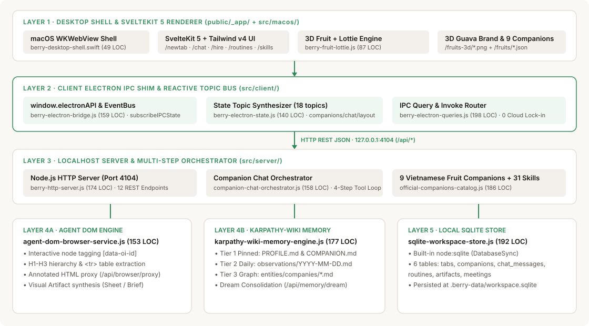

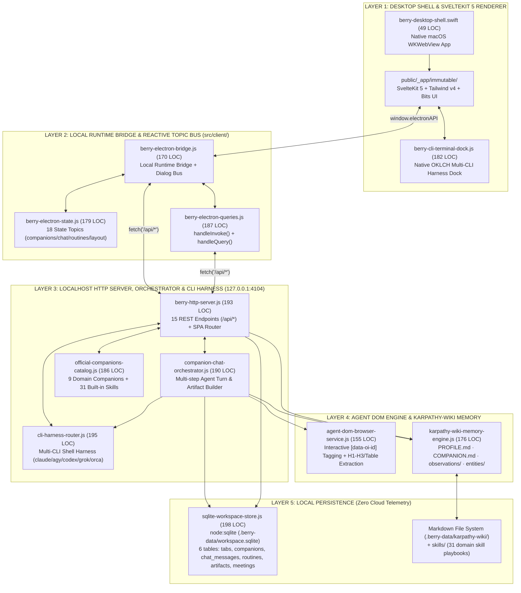

### End-to-End Execution Flow (Boot → Companion Turn → CLI Harness → DOM Inspect → Wiki Memory)

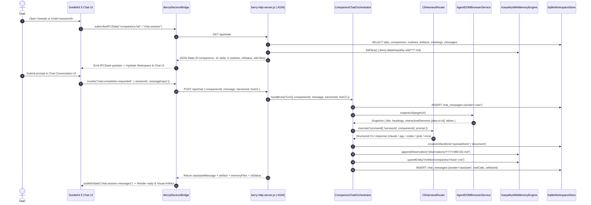

---

## Deep Dive into Core Features

### 1. Local Runtime Bridge & 18-Topic Reactive State Bus
- **Modules**: [`src/client/berry-electron-bridge.js`](src/client/berry-electron-bridge.js), [`src/client/berry-electron-state.js`](src/client/berry-electron-state.js), [`src/client/berry-electron-queries.js`](src/client/berry-electron-queries.js), [`src/client/berry-electron-domains.js`](src/client/berry-electron-domains.js).
- **How it works**:
  - Loaded in [`public/index.html`](public/index.html) prior to SvelteKit's bootstrap, providing the local runtime bridge and dialog bus.
  - Translates 18 real-time state topics (`companions.list`, `routines.list`, `syncedFs.library`, `syncedFs.status`, `skills.list`, `skills.folders`, `chat.statusIndex`, `chat.session`, `chat.session.messages`, `chat.metadata`, `layout.tree`, `ui.theme`, `ui.windowChrome`, `onboarding.checklist`, `profile.usage`, etc.) directly to localhost REST responses from `GET /api/state`.
  - Operates 100% locally against the workspace SQLite database and Multi-CLI Shell Harness with zero cloud dependencies or external telemetry.

### 2. Multi-CLI Shell Harness Core & Interactive Terminal Dock (Orca ADE Mode)
- **Modules**: [`src/server/cli-harness-router.js`](src/server/cli-harness-router.js) & [`src/client/berry-cli-terminal-dock.js`](src/client/berry-cli-terminal-dock.js).
- **How it works**:
  - Automatically discovers installed AI CLI binaries on the host machine (`claude`, `agy`, `codex`, `grok`, `orca`) with zero paid API key configuration, reusing existing local CLI subscriptions.
  - Maps each companion to its specialized CLI core in `Auto` mode (`Ổi` → `claude`, `Măng Cụt` → `agy`, `Sầu Riêng` / `Thanh Long` → `grok`, `Bưởi` / `Xoài` → `codex`, `Vú Sữa` / `Chôm Chôm` / `Vải` → `agy`) while falling back gracefully to the zero-latency `Local Deterministic` engine when offline.
  - Embeds an expandable **`>_ CLI Core` Terminal Dock** (`?cliDock=open`) styled with Ổi Browser's native OKLCH design tokens for one-click harness switching and live CLI execution (`POST /api/cli/exec`).

### 3. 9 Specialized Domain Companions & Role Playbooks
- **Module**: [`src/server/official-companions-catalog.js`](src/server/official-companions-catalog.js).
- **How it works**:
  - Pre-configures 9 role-specialized companions, each wired to domain-specific skill playbooks in `skills/`:
    1. **Ổi** (Strategy & Consulting) — Discovery synthesis, executive decks, proposals, and client progress reports.
    2. **Măng Cụt** (Software Engineering & QA) — Release testing, bug triage, DOM diagnostics, and technical specs.
    3. **Sầu Riêng** (Chief of Staff & Executive Ops) — Morning briefs, board prep, inbox triage, and decision logs.
    4. **Thanh Long** (Growth & Product Marketing) — Brand voice analysis, launch positioning, and omnichannel social copy.
    5. **Bưởi** (Operations & Process Systems) — Sprint follow-ups, SOP checklists, and vendor risk tracking.
    6. **Vú Sữa** (Deep Research & Web Synthesis) — Multi-source market intelligence and structured web-to-spreadsheet extraction.
    7. **Xoài** (Revenue & Account Pipeline) — ICP lead scoring, call prep briefs, CRM hygiene, and outbound sequences.
    8. **Chôm Chôm** (Customer Support & Triage) — P1–P4 ticket classification, root-cause reproduction, and reply drafting.
    9. **Vải** (Talent & Recruiting) — Candidate sourcing, competency scorecards, and outreach messages.

### 4. `AgentDOMBrowserService` & Interactive Element Tagging (`[data-oi-id]`)
- **Module**: [`src/server/agent-dom-browser-service.js`](src/server/agent-dom-browser-service.js).
- **How it works**:
  - Fetches target web pages with an 8-second timeout, strips `<script>` and `<style>` noise, extracts `<title>`, `<meta name="description">`, and up to 15 `H1–H3` headings.
  - Assigns deterministic sequential IDs (`oi-1`, `oi-2`, ...) to interactive `<a>` and `<button>` elements (`interactiveElements`) and extracts structured HTML table rows (`<tr><td>`).
  - Serves live annotated HTML via `GET /api/browser/proxy?url=...` with `data-oi-id="oi-1..N"` injected into every interactive tag so user and agent share identical DOM references.

### 5. 3-Tier Karpathy-Wiki Markdown Memory & Dream Consolidation
- **Module**: [`src/server/karpathy-wiki-memory-engine.js`](src/server/karpathy-wiki-memory-engine.js) + [`skills/general/memory-best-practices/SKILL.md`](skills/general/memory-best-practices/SKILL.md).
- **How it works**:
  - Organizes all persistent knowledge as human-readable Markdown files under `.berry-data/karpathy-wiki/`:
    - **Tier 1 — Pinned Memory (`< 4 KB`)**: `PROFILE.md` (workspace owner rules) and `companions/<id>/COMPANION.md` (companion-specific role, skills, and learned patterns).
    - **Tier 2 — Daily Observations**: `observations/YYYY-MM-DD.md` logs timestamped agent actions and source URLs after every chat turn or meeting transcription.
    - **Tier 3 — Entity Knowledge Graph**: `entities/index.md` and `entities/{companies,people,projects,deals}/<slug>.md` automatically compile domain-level pages for inspected websites.
  - **Dream Consolidation (`POST /api/memory/dream`)**: Distills the 8 most recent daily observations into a timestamped `### Dream Consolidation` section inside `companions/<id>/COMPANION.md`.

### 6. Multi-Step Companion Chat Orchestrator & Visual Artifacts
- **Module**: [`src/server/companion-chat-orchestrator.js`](src/server/companion-chat-orchestrator.js).
- **How it works**:
  - Each `POST /api/chat` turn executes a deterministic pipeline:
    1. `browser_inspect_dom`: Inspects the target URL or active tab DOM.
    2. `cli_harness_dispatch`: Routes the prompt and workspace context through the active AI CLI harness (`claude`, `agy`, `codex`, `grok`, `orca`).
    3. `create_visual_artifact`: Synthesizes a structured **Spreadsheet Artifact** (`columns: ["ID", "Type", "Content", "Reference"]`) when table/data extraction is requested, or a **Document Artifact** with `[data-oi-id]` citations.
    4. `karpathy_wiki_memory_write` & `karpathy_wiki_entity_upsert`: Appends a dated entry to `observations/YYYY-MM-DD.md` and updates `entities/companies/<domain>.md`.

### 7. 31 Domain Skill Playbooks & Automated Brand Probe / Visual Critique Engine
- **Directory**: [`skills/`](skills/) (`31` built-in domain skill playbooks).
- **How it works**:
  - Includes domain playbooks across Consulting, Support, Founder, Marketing, Operations, Engineering, Recruiting, Research, and Sales, plus core system engines:
    - [`skills/general/visual-artifact/`](skills/general/visual-artifact/SKILL.md) (`48` TypeScript/JS files): Automated brand extraction and visual critique pipeline (`brand-fetch.ts`, `brand-probe.ts`, `brand-pixels.ts`, `brand-color-math.ts`, `brand-color-confidence.ts`, `brand-fonts.ts`, `brand-logo-font.ts`, `critique.ts`, `frame-contract.ts`).
    - [`skills/general/spreadsheets/SKILL.md`](skills/general/spreadsheets/SKILL.md): Checkpoint-based spreadsheet modeling and `Formualizer` validation workflow.
    - [`skills/general/linkedin/SKILL.md`](skills/general/linkedin/SKILL.md): Account-safe DOM-only LinkedIn Sales Navigator & Recruiter Lite operating rules.

### 8. Scheduled Browser Routines, Meeting Transcriptions & `node:sqlite` Store
- **Modules**: [`src/server/sqlite-workspace-store.js`](src/server/sqlite-workspace-store.js) & [`src/server/berry-http-server.js`](src/server/berry-http-server.js).
- **How it works**:
  - Uses Node.js 22+ built-in `DatabaseSync` (`node:sqlite`) to manage 6 relational tables (`tabs`, `companions`, `chat_messages`, `routines`, `artifacts`, `meetings`) inside `.berry-data/workspace.sqlite`.
  - Executes recurring workflows (`morning-priorities`, `competitor-pulse`, `inbox-triage`, `pr-review-sweep`, `pipeline-hygiene`) via `POST /api/routines/run` and extracts structured `Action Items` from meeting transcripts via `POST /api/meetings`.

---

## Install once

Clone the repository and start the local-first server on port `4104`:

```bash
git clone https://github.com/jangtrinh/oi-browser.git
cd oi-browser
npm test
npm start
```

---

## First safe use

1. Run the automated full-stack test suite (SQLite state, CLI harness router, DOM agent, Dream Consolidation):
   ```bash
   npm test
   ```
2. Inspect the local state register (9 companions, 31 skills, 5 routines, CLI harnesses, Karpathy-Wiki files):
   ```bash
   curl -s http://127.0.0.1:4104/api/state | jq '.cliStatus.harnesses[] | {id, installed, binaryPath}'
   ```
3. Build and launch the native macOS `WKWebView` desktop bundle:
   ```bash
   npm run build:macos
   ```

---

## A practical loop

| Endpoint | Description |
| :--- | :--- |
| `GET /api/state` | Returns the 9 companions, open tabs, 31 skills, 5 scheduled routines, Karpathy-Wiki Markdown files, and `cliStatus`. |
| `GET /api/cli/status` | Probes installed AI CLI harnesses (`claude`, `agy`, `codex`, `grok`, `orca`, `local`), companion affinities, and recent CLI runs. |
| `POST /api/cli/exec` | Executes a command or prompt through the selected AI CLI harness (`child_process.spawn`) and returns structured stdout/exit telemetry. |
| `POST /api/chat` | Runs `AgentDOMBrowserService` (`[data-oi-id]`), dispatches `CliHarnessRouter`, creates Visual Artifacts, and appends Karpathy-Wiki observations. |
| `POST /api/memory/dream` | Consolidates recent session observations directly into the companion's persistent `COMPANION.md` profile. |
| `POST /api/routines/run` | Executes scheduled browser routines and persists structured execution logs in SQLite. |

---

## Live Demo Gallery — 14 End-to-End Use Cases (`Grok Build` CLI Core)

All 14 official workflows executed directly inside **Ổi Browser's Chat Conversation UI** (`1440×900`) with `CLI Core: GROK (5/5)` (`grok-4.7-build-fast`):

### 1. Sales — ICP Scoring & Outbound Outreach (`Xoài`)
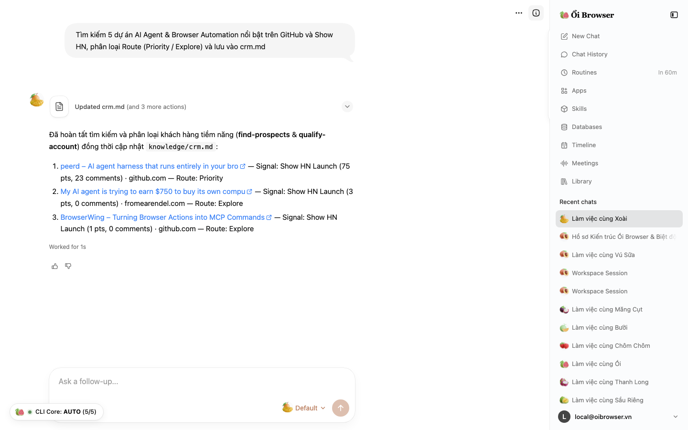

### 2. Recruiting — Principal Engineer Scorecard & Outreach (`Vải`)
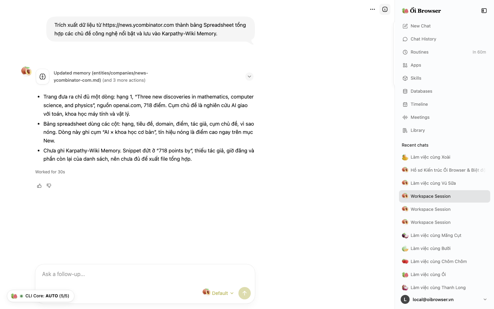

### 3. Executive — Q4 Morning Brief, Board Prep & Inbox Triage (`Sầu Riêng`)


### 4. Marketing — Technical Brand Voice & Omnichannel Copy (`Thanh Long`)


### 5. Consulting — 3-Phase AI Transformation Proposal & KPIs (`Ổi`)
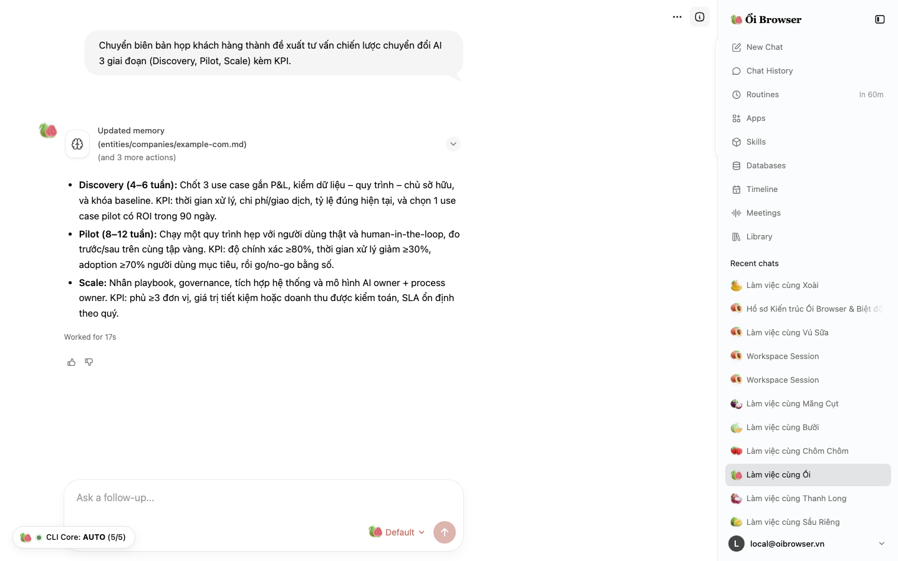

### 6. Customer Support — P1 SAML SSO Triage & Resolution Steps (`Chôm Chôm`)


### 7. Operations — Weekly Sprint Status & Cross-Team Follow-ups (`Bưởi`)


### 8. Engineering & QA — Release Testing & Reproducible Bug Filing (`Măng Cụt`)
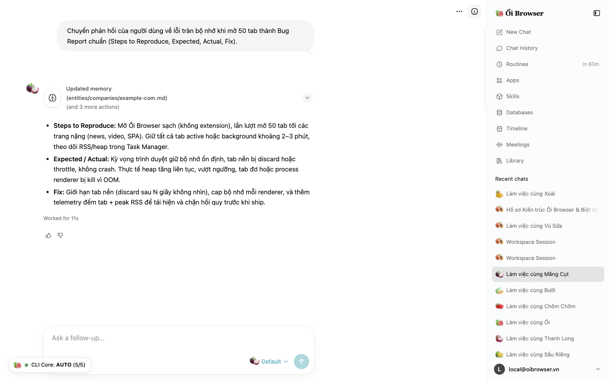

### 9. Deep Research — Live Web Data to Spreadsheet Extraction (`Vú Sữa`)
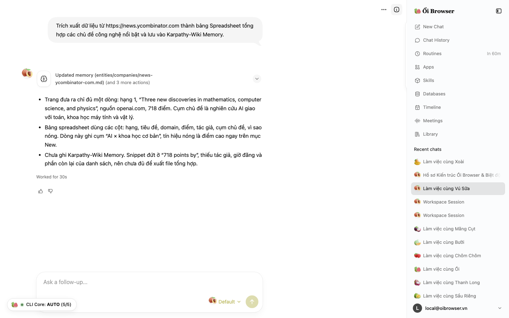

### 10. Companion Directory & Custom Companion Builder (`/hire/official`)
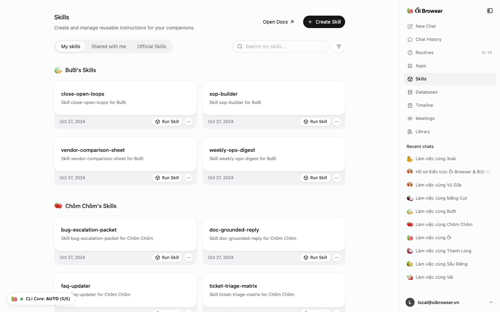

### 11. Browser Agent Live DOM Inspection (`[data-oi-id]`) & Multi-CLI Harness Dock
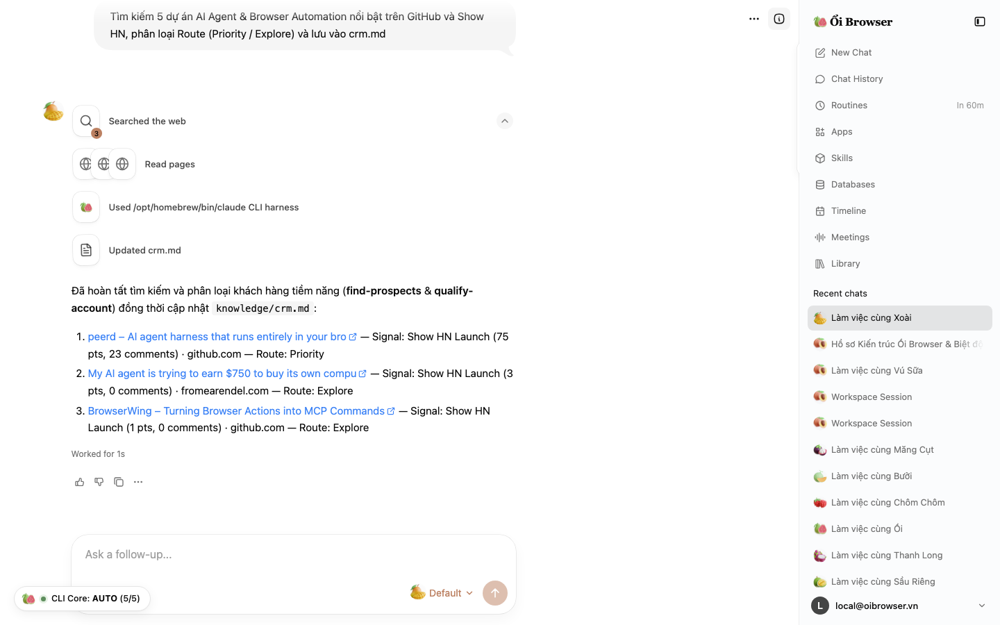

### 12. Visual Artifacts & Karpathy-Wiki Workspace Library (`/library`)
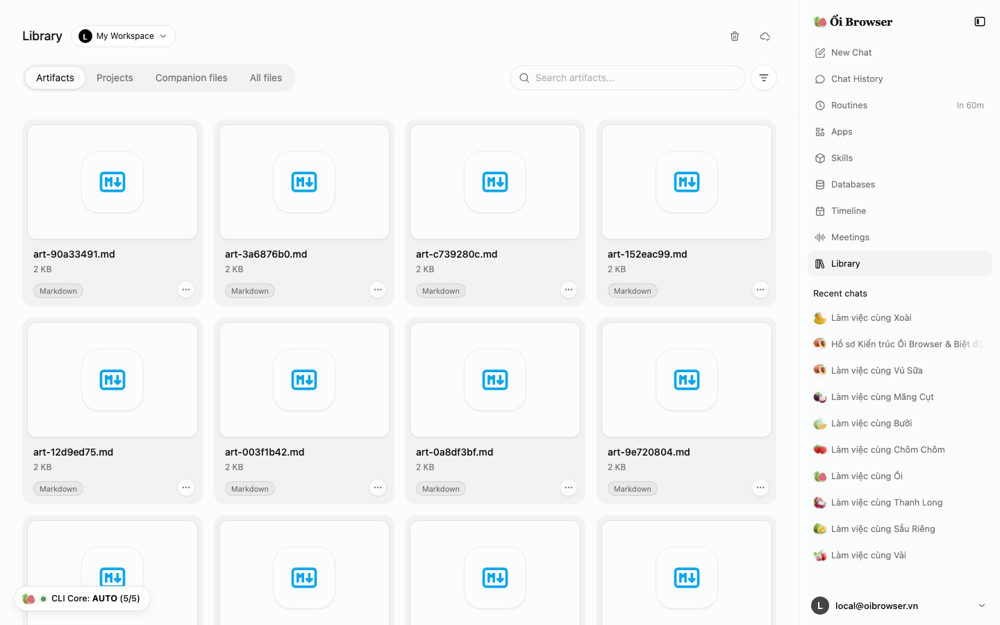

### 13. Automated Meeting Notes, Transcripts & Action Items (`/meetings`)
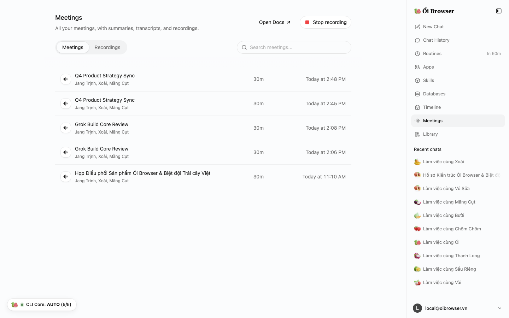

### 14. Scheduled `When -> Then` Browser Routines (`/routines`)
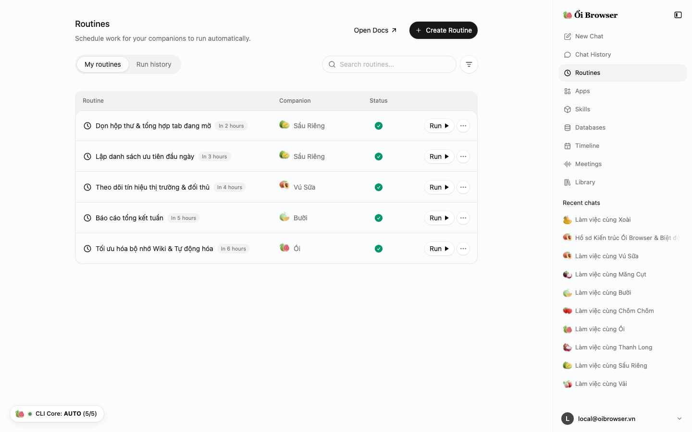

### 15. Apps & Managed MCP Integrations (`/apps`)
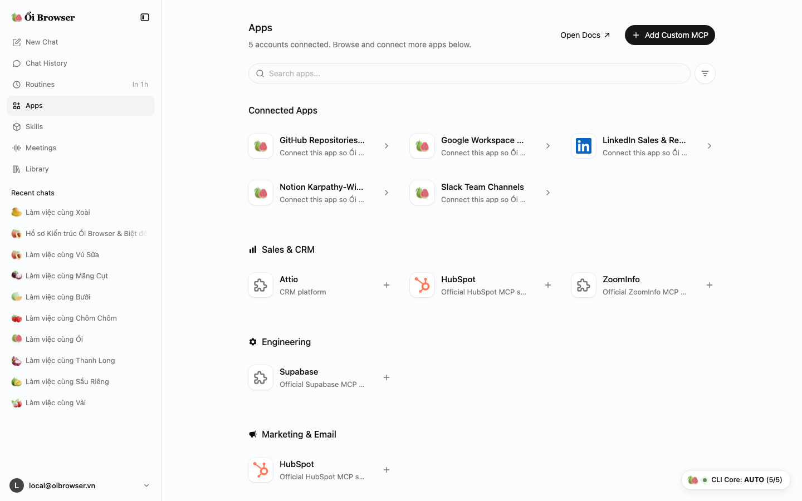

### 16. Agent SQLite Databases & Companion Grants (`/databases`)
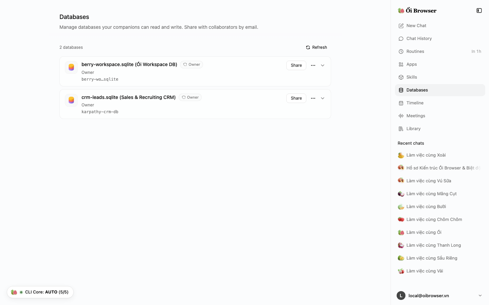

### 17. Gia Activity Memory & Daily/Weekly Timeline (`/timeline`)
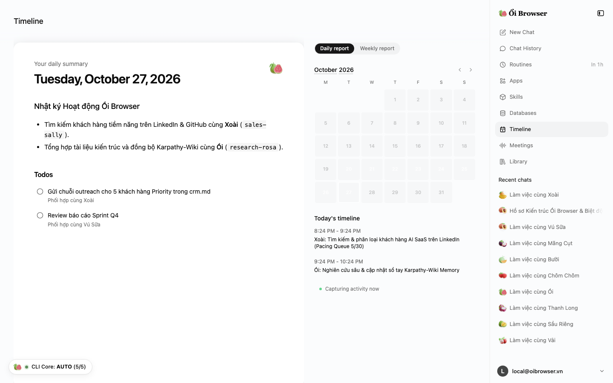

### 18. Use Cases & Official Skill Starter Kits (`/use-cases`)
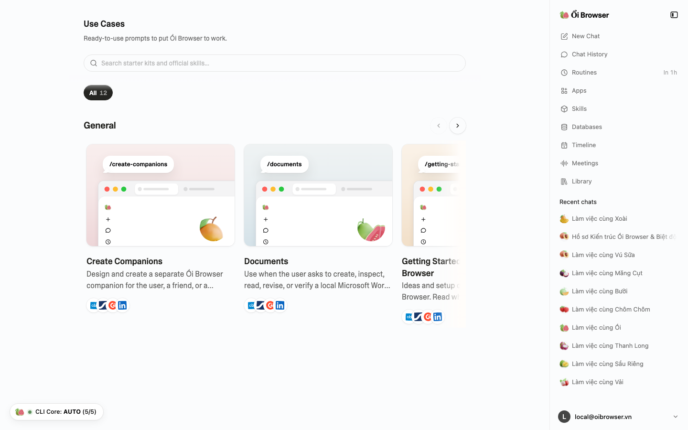

---

## Source Modules (`< 200` lines per custom file)

| File | Lines | Responsibility |
| :--- | :---: | :--- |
| [`src/server/sqlite-workspace-store.js`](src/server/sqlite-workspace-store.js) | `198` | Built-in `node:sqlite` state persistence (6 tables) |
| [`src/server/cli-harness-router.js`](src/server/cli-harness-router.js) | `195` | Orca ADE-style Multi-CLI Shell Harness discovery & execution router |
| [`src/server/berry-http-server.js`](src/server/berry-http-server.js) | `193` | Localhost HTTP & REST API server (`127.0.0.1:4104`) |
| [`src/server/companion-chat-orchestrator.js`](src/server/companion-chat-orchestrator.js) | `190` | Companion chat, CLI harness dispatch & Visual Artifact orchestrator |
| [`src/server/official-companions-catalog.js`](src/server/official-companions-catalog.js) | `186` | 9 domain companions, 5 routines & 31 official skills |
| [`src/server/karpathy-wiki-memory-engine.js`](src/server/karpathy-wiki-memory-engine.js) | `176` | 3-tier Markdown memory engine & Dream Consolidation |
| [`src/server/agent-dom-browser-service.js`](src/server/agent-dom-browser-service.js) | `155` | Agentic DOM tagging (`[data-oi-id]`), GitHub/HN/LinkedIn lead discovery |
| [`src/client/berry-electron-queries.js`](src/client/berry-electron-queries.js) | `187` | IPC `invoke` & `invokeIPCQuery` core router |
| [`src/client/berry-electron-domains.js`](src/client/berry-electron-domains.js) | `182` | Apps, Databases, Activity Timeline, Meetings, Credits & Knowledge IPC domains |
| [`src/client/berry-cli-terminal-dock.js`](src/client/berry-cli-terminal-dock.js) | `182` | Interactive `>_ CLI Core` Terminal Dock & harness switcher UI |
| [`src/client/berry-electron-state.js`](src/client/berry-electron-state.js) | `179` | 18-topic state synthesizer, native tool-card mapper & session builder |
| [`src/client/berry-electron-bridge.js`](src/client/berry-electron-bridge.js) | `170` | Local runtime bridge & reactive subscription bus |
| [`src/client/berry-fruit-lottie.js`](src/client/berry-fruit-lottie.js) | `87` | Companion avatar asset & animation loader |
| [`src/macos/berry-desktop-shell.swift`](src/macos/berry-desktop-shell.swift) | `49` | Native macOS `WKWebView` desktop shell (`BerryBrowser.app`) |

---

## License

Source-available under the [PolyForm Shield License 1.0.0](LICENSE). Free to use and modify, including for commercial work, provided you do not resell it or offer a competing product.
