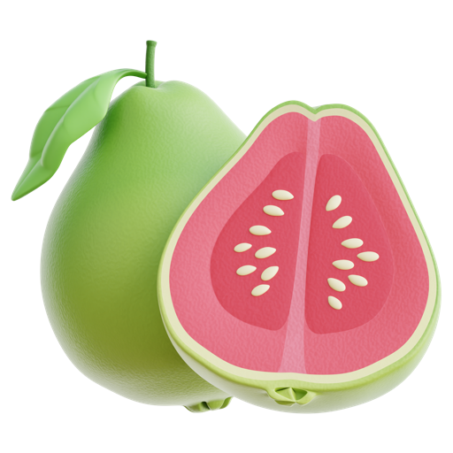
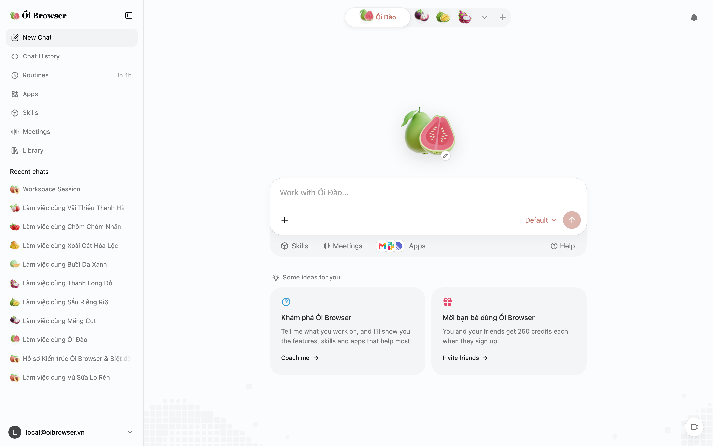
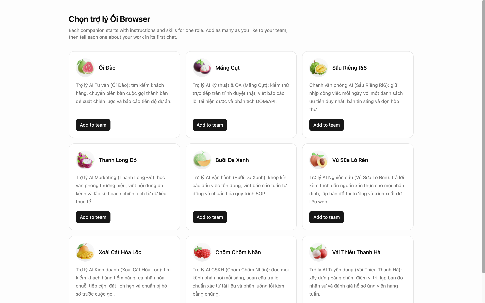
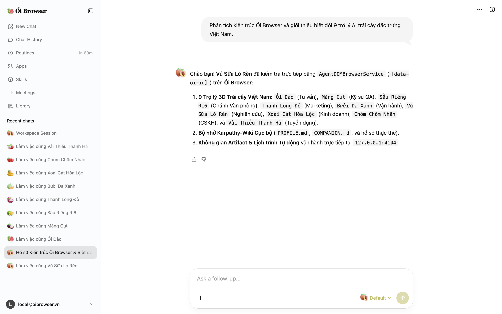
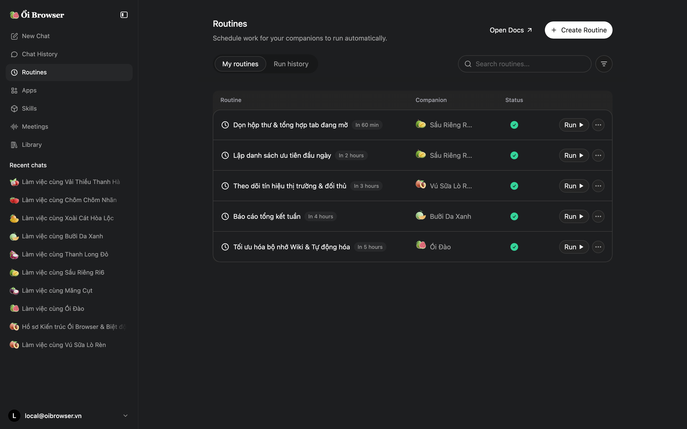

#  Ổi Browser

**Local-first AI browser and 9 Vietnamese fruit companions with Karpathy-Wiki markdown memory and zero cloud telemetry.**

Ổi Browser is a zero-dependency, self-hosted agentic AI browser with 9 3D Vietnamese fruit companions, DOM agent automation, and local SQLite + Markdown memory.

[](test/berry-browser.test.js)
[](https://github.com/jangtrinh/oi-browser/releases)
[](LICENSE)




---

## What it is

| Property | Specification |
| :--- | :--- |
| **Repository** | [`jangtrinh/oi-browser`](https://github.com/jangtrinh/oi-browser) |
| **Requires** | Node.js 22.5+ (Zero external npm runtime dependencies) |
| **Interface** | Web UI (`SvelteKit 5`) + Native macOS `WKWebView` App |
| **Transport** | `127.0.0.1:4104` (REST + `window.electron` IPC Bridge) |
| **Telemetry** | Zero Tracking (Local SQLite + Karpathy-Wiki Markdown) |
| **License** | [PolyForm Shield 1.0.0](LICENSE) (Source-available) |

---

## Why Ổi Browser, compared with alternatives

1. **9 Vietnamese Fruit Companions (3D + Lottie)**: `Ổi Đào` (`guava.png`), `Măng Cụt` (`mangosteen.png`), `Sầu Riêng Ri6` (`durian.png`), `Thanh Long Đỏ` (`dragon-fruit.png`), `Bưởi Da Xanh` (`melon.png`), `Vú Sữa Lò Rèn` (`peach.png`), `Xoài Cát Hòa Lộc` (`mango.png`), `Chôm Chôm Nhãn` (`raspberry.png`), and `Vải Thiều Thanh Hà` (`lychee.png`) — each with custom skills and floating 3D fruit renders.
2. **Karpathy-Wiki Markdown Memory & Dream Consolidation**: Plaintext Markdown knowledge base (`PROFILE.md`, `COMPANION.md`, `observations/*.md`) with one-click Dream Consolidation.
3. **Local-first privacy & zero dependencies**: Built on Node.js 22+ native `node:sqlite` and `node:http`. Zero external npm packages, zero cloud lock-in, zero telemetry.
4. **Agentic DOM Browser Automation (`[data-oi-id]`)**: Deterministic element tagging, live DOM inspection, and structured Visual Artifacts (Spreadsheets, Slide Decks, Interactive Charts).

> **Where traditional platforms win, and it is not close:** Managed enterprise clouds with out-of-the-box multi-tenant SSO, compliance audits, and commercial SLAs. If you need centralized team dashboards without hosting your own infrastructure, choose those platforms instead.

---

## Install once

Clone the repository and start the local-first server on port `4104`:

```bash
git clone https://github.com/jangtrinh/oi-browser.git
cd oi-browser
npm test
npm start
```

---

## First safe use

1. Run the automated full-stack test suite (SQLite state, 3D fruit assets, DOM agent, Dream Consolidation):
   ```bash
   npm test
   ```
2. Inspect the local state register (9 Vietnamese fruit companions, 31 skills, 5 routines, Karpathy-Wiki files):
   ```bash
   curl -s http://127.0.0.1:4104/api/state | jq '.companions[].name'
   ```
3. Build and launch the native macOS `WKWebView` desktop bundle with the 3D Guava app icon:
   ```bash
   npm run build:macos
   ```

---

## A practical loop

| Endpoint | Description |
| :--- | :--- |
| `GET /api/state` | Returns the 9 Vietnamese fruit companions, open tabs, 31 skills, 5 scheduled routines, and Karpathy-Wiki Markdown files. |
| `POST /api/chat` | Runs the `AgentDOMBrowserService` with `[data-oi-id]` tagging, creates Visual Artifacts, and appends Karpathy-Wiki observations. |
| `POST /api/memory/dream` | Consolidates recent session observations directly into the companion's persistent `COMPANION.md` profile. |
| `POST /api/routines/run` | Executes scheduled browser routines and persists structured execution logs in SQLite. |

---

## Verified interface gallery

### 1. Companion Plaza (`/newtab`)
3D Guava brand wordmark in the sidebar, floating 3D Guava centerpiece, and active Vietnamese fruit companion chats.


### 2. Vietnamese Fruit Companions (`/hire/official`)
All 9 specialized companions rendered with IconScout 3D tropical fruit icons (`Ổi Đào`, `Măng Cụt`, `Sầu Riêng Ri6`, `Thanh Long Đỏ`, `Bưởi Da Xanh`, `Vú Sữa Lò Rèn`, `Xoài Cát Hòa Lộc`, `Chôm Chôm Nhãn`, `Vải Thiều Thanh Hà`).



### 3. Companion Chat & DOM Agent (`/chat/session-rosa-1`)
Interactive chat with `Vú Sữa Lò Rèn` featuring 3D fruit avatar pills, `[data-oi-id]` DOM inspection, and Karpathy-Wiki memory logging.



### 4. Scheduled Routines Dark Mode (`/routines?theme=dark`)
Automated browser routines and recurring research workflows rendered in dark theme with the 3D Guava wordmark.



---

## Architecture (`< 200` lines per custom module)

- `src/server/berry-http-server.js` — Localhost HTTP & REST API server (`127.0.0.1:4104`)
- `src/server/sqlite-workspace-store.js` — Built-in `node:sqlite` state persistence
- `src/server/official-companions-catalog.js` — 9 Vietnamese fruit companions & 31 official skills
- `src/server/karpathy-wiki-memory-engine.js` — Markdown memory engine (`PROFILE.md`, `COMPANION.md`, `observations/*.md`, Dream Consolidation)
- `src/server/agent-dom-browser-service.js` — Agentic DOM tagging (`[data-oi-id]`) & visual artifact synthesizer
- `src/server/companion-chat-orchestrator.js` — Companion chat & routine execution orchestrator
- `src/client/berry-electron-bridge.js` — `window.electron` IPC shim bridging SvelteKit 5 to `/api/*`
- `src/client/berry-electron-queries.js` — IPC query handlers
- `src/client/berry-electron-state.js` — Local workspace state & custom theme manager
- `src/client/berry-fruit-lottie.js` — 3D Vietnamese fruit icon & Lottie animation engine
- `src/macos/berry-desktop-shell.swift` — Native macOS `WKWebView` desktop shell

---

## License

Source-available under the [PolyForm Shield License 1.0.0](LICENSE). Free to use and modify, including for commercial work, provided you do not resell it or offer a competing product.
